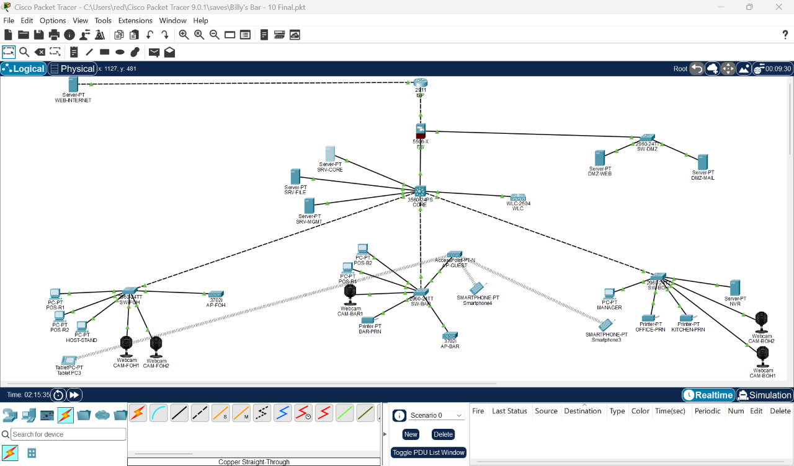
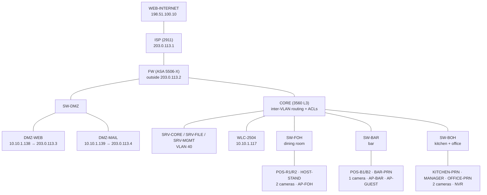

# 🍔 Billy's Bar & Grill: Small Business Network Build


-brightgreen)


A complete, secured network for a restaurant client, designed and built from scratch in **Cisco Packet Tracer** as CCNA practice.

I approached it like my own IT company had landed a restaurant client: they needed separate networks for the bar and dining room, protected card payments, security cameras, customer Wi-Fi, file sharing, a public website, and a firewall, all on a small-business budget. I designed the addressing, built it device by device, tested every rule both ways, and documented every problem I hit.

> 📄 **Start here:** the [**Project Report**](docs/PROJECT-REPORT.md) explains what I built, how I built it, the troubleshooting, and why this design fits the client's budget and needs.



---

## Contents

- [What's in it](#whats-in-it)
- [Topology](#topology)
- [IP plan](#ip-plan)
- [Security policy](#security-policy)
- [Build steps](#build-steps)
- [Problems I ran into](#problems-i-ran-into)
- [Known limitations](#known-limitations)
- [Documentation](#documentation)
- [Repo layout](#repo-layout)
- [How to open it](#how-to-open-it)

---

## What's in it

| Area | What I built |
|---|---|
| **Switching** | 9 VLANs, 802.1Q trunks, native VLAN 99, unused ports parked in a shut-down BLACKHOLE VLAN, VLAN 1 left empty |
| **Routing** | Inter-VLAN routing on a Layer 3 switch (SVIs), a routed uplink to the firewall, default routes |
| **Services** | Centralized DHCP with `ip helper-address`, internal DNS (`billysbar.local`), FTP file share, Syslog, NTP |
| **Wireless** | WLC-2504 with two lightweight 3702i APs (staff Wi-Fi) + an isolated guest AP |
| **Firewall** | ASA 5506-X with outside / inside / DMZ zones, PAT for staff internet, static NAT for public servers, stateful inspection |
| **DMZ** | Restaurant website reachable from the internet, mail server, DMZ can't reach inside |
| **Security** | SSH-only management, encrypted passwords, login banner, port security, ACLs isolating POS / cameras / guests, unused services disabled |

---

## Topology



**Design choice:** I segmented by **function, not by department**. A bar POS and a restaurant POS need the same protection, so they share the POS VLAN even though they sit on different switches. The switches represent physical locations, and the VLANs span across them.

---

## IP plan

Base network **10.10.0.0/23**, split with VLSM (largest subnet first, gateway = first usable).

| VLAN | Name | Subnet | Gateway | Used for |
|---|---|---|---|---|
| 70 | GUEST-WIFI | 10.10.0.0/24 | 10.10.0.1 | Customer phones |
| 60 | STAFF-WIFI | 10.10.1.0/27 | 10.10.1.1 | Staff tablets |
| 20 | POS | 10.10.1.32/27 | 10.10.1.33 | POS terminals, kitchen + bar printers |
| 30 | STAFF | 10.10.1.64/27 | 10.10.1.65 | Manager PC, host stand, office printer |
| 50 | CCTV | 10.10.1.96/28 | 10.10.1.97 | Cameras + NVR |
| 10 | MGMT | 10.10.1.112/28 | 10.10.1.113 | Switches, WLC, APs |
| 40 | SERVERS | 10.10.1.128/29 | 10.10.1.129 | DHCP/DNS, file, Syslog/NTP |
| — | DMZ | 10.10.1.136/29 | 10.10.1.137 (FW) | Web + mail |
| — | FW ↔ CORE | 10.10.1.144/30 | — | FW .145, CORE .146 |
| — | Outside | 203.0.113.0/29 | — | ISP .1, FW .2, web .3, mail .4 |
| 99 | NATIVE | — | — | Unused native VLAN for trunks |
| 999 | BLACKHOLE | — | — | All unused ports (shut down) |

Device addresses, DHCP pools, and DNS records are in [`configs/servers.md`](configs/servers.md).

---

## Security policy

This is what the ACLs on CORE and the firewall enforce:

| From | Allowed | Blocked |
|---|---|---|
| **Guest Wi-Fi** | Internet, DHCP, DNS | Everything internal |
| **POS** | Internet (payment processor), DHCP, DNS, NTP | All internal networks (PCI-DSS style isolation) |
| **Cameras** | NVR only (same VLAN) | Internet and every other VLAN, so a hacked camera can't phone home |
| **Staff** | Servers, NVR footage, DMZ, internet | POS, cameras, management (except the MANAGER admin PC) |
| **Staff Wi-Fi** | Servers, DMZ, internet | POS, cameras, management |
| **Internet** | Website (TCP 80) and mail (TCP 25) in the DMZ, ping replies | Everything else |
| **DMZ** | Replies to the internet | Starting connections to the inside |

Device hardening on every switch:
- `enable secret` and `service password-encryption`
- Local admin user, **SSH v2 only** (no Telnet), exec timeouts
- Login banner
- Port security: max 1 MAC, sticky, violation restrict
- Unused ports → VLAN 999 + shutdown

On the servers, I turned off every service a box didn't need (least functionality) and removed the default `cisco/cisco` FTP accounts.

---

## Build steps

| # | Step | Proof |
|---|---|---|
| 1 | Placed ~35 devices, cabled with straight-through / cross-over | [screenshot](screenshots/01-cabling-complete.png) |
| 2 | VLANs on all switches, access ports, trunks with native VLAN 99 | [VLANs](screenshots/02-core-vlans.png) · [access ports](screenshots/03-sw-foh-access-ports.png) · [trunks](screenshots/04-core-trunks-forwarding.png) |
| 3 | `ip routing` + SVIs on CORE, static IPs on servers | [SVIs up](screenshots/05-core-svis-up.png) · [routing test](screenshots/06-intervlan-routing-ping.png) |
| 4 | DHCP pools on SRV-CORE, `ip helper-address` relay, static printers/NVR | [pools](screenshots/07-dhcp-pools.png) · [POS gets IP](screenshots/08-pos-dhcp-success.png) · [TTL proof](screenshots/09-cross-vlan-ping-ttl.png) |
| 5 | DNS, FTP with least-privilege users, switch management IPs, Syslog + NTP | [DNS](screenshots/10-dns-resolution.png) · [FTP](screenshots/11-ftp-login.png) · [Syslog](screenshots/12-syslog-all-switches.png) |
| 6 | WLC setup, APs joined, staff + guest WLANs | [dashboard](screenshots/13-wlc-dashboard.png) · [APs joined](screenshots/14-wlc-aps-joined.png) · [interfaces](screenshots/15-wlc-interfaces.png) · [WLANs](screenshots/16-wlc-wlans.png) |
| 7 | ISP router, ASA zones, routes, PAT, inspection | [ASA up](screenshots/17-asa-interfaces-ping-isp.png) · [NAT xlate](screenshots/18-asa-nat-xlate.png) · [internet ping](screenshots/19-internet-ping-ttl125.png) · [browsing](screenshots/21-internet-web-browsing.png) |
| 7E | DMZ, static NAT, website live on the internet | [internal](screenshots/22-billys-website-internal.png) · [static NAT](screenshots/24-asa-static-nat-dmz.png) · [**from the internet**](screenshots/25-website-from-internet.png) · [DMZ isolated](screenshots/26-dmz-isolation-test.png) · [ACL hits](screenshots/27-asa-acl-hitcounts.png) |
| 8 | SSH, blackhole VLAN, port security, ACLs, service hardening | [SSH](screenshots/28-ssh-login-banner.png) · [VLAN 999](screenshots/29-blackhole-vlan-999.png) · [port security](screenshots/30-port-security.png) · [POS ACL](screenshots/31-acl-pos-isolation.png) · [CCTV ACL](screenshots/32-acl-cctv-no-internet.png) · [staff ACL](screenshots/33-acl-staff-test.png) |
| 9 | Guest Wi-Fi fixed and isolated | [guest IP](screenshots/36-guest-wifi-fixed-ip.png) · [**isolation test**](screenshots/37-guest-isolation-test.png) |

---

## Problems I ran into

The full write-up is in [`docs/troubleshooting-log.md`](docs/troubleshooting-log.md), and every test I ran is in [`docs/test-plan.md`](docs/test-plan.md). The highlights:

1. **Guest Wi-Fi users landed in the management VLAN.** I spent hours ruling out the WLC config, AP groups, DHCP proxy, and trunking. The real fix was replacing an old `AP-PT` with an 802.11n `AP-PT-N`. ([bug](screenshots/34-bug-guest-in-mgmt-vlan.png) → [fixed](screenshots/36-guest-wifi-fixed-ip.png))
2. **Packet Tracer's ASA doesn't support port forwarding** (`static interface service`). I solved it the way real businesses do, with a /29 public block and 1-to-1 static NAT. ([error](screenshots/23-asa-no-port-forwarding-error.png))
3. **Web browsing timed out while ping worked.** A Simulation trace showed it was ARP warm-up across 5 hops, not a broken config. ([trace](screenshots/20-simulation-tcp-arp-warmup.png))
4. **A firewall rule had the wrong IP** (.138 instead of .139). I caught it by reviewing `show access-list`.
5. **IoT webcams don't answer cross-VLAN pings** in Packet Tracer. Camera ↔ NVR traffic works, which is all the design allows anyway.

---

## Known limitations

- **FTP sends passwords in plain text.** A real deployment would use SFTP; Packet Tracer only has FTP.
- **Website is HTTP only.** The next improvement would be HTTPS (port 443) on DMZ-WEB and opening only 443.
- **DMZ-MAIL** has its IP, NAT, and firewall rule, but the mail service itself wasn't configured.
- **Guest Wi-Fi runs on a standalone AP** instead of through the WLC, because of the PT behavior described above.
- **Passwords in `configs/`** are lab-only placeholder values. In a real network, they'd never be published.

## Future improvements

- RADIUS (WPA2-Enterprise) for staff Wi-Fi on SRV-MGMT
- DHCP snooping + Dynamic ARP Inspection on the access switches
- Voice VLAN with IP phones at the host stand
- Second location connected with OSPF and a site-to-site VPN
- HSRP / a redundant core

---

## Documentation

| Document | What it covers |
|---|---|
| [Project Report](docs/PROJECT-REPORT.md) | Client brief, budget and design decisions, lab vs real-world gear, build process, results, lessons learned |
| [Troubleshooting Log](docs/troubleshooting-log.md) | Six real problems: symptoms, how I isolated them, and the fix |
| [Test Plan](docs/test-plan.md) | 32 connectivity and security tests with screenshot evidence |
| [Device configs](configs/) | Full CLI for CORE, the 3 access switches, the ASA and the ISP, plus WLC and server settings |

---

## Repo layout

```
billys-bar-network/
├── README.md
├── LICENSE
├── configs/          CLI configs per device + GUI settings (WLC, servers)
│   ├── CORE.txt
│   ├── SW-FOH.txt  SW-BAR.txt  SW-BOH.txt
│   ├── FW-ASA5506.txt  ISP.txt
│   └── WLC-and-wireless.md  servers.md
├── docs/
│   ├── PROJECT-REPORT.md
│   ├── troubleshooting-log.md
│   └── test-plan.md
├── pkt/              Packet Tracer snapshots, one per build step + the final network
└── screenshots/      38 screenshots proving each step
```

---

## How to open it

1. Install **Cisco Packet Tracer 9.0.1** or newer (free with a [Cisco Networking Academy](https://www.netacad.com/) account).
2. Open [`pkt/billys-bar-FINAL.pkt`](pkt/billys-bar-FINAL.pkt). To watch the build progress, open the numbered snapshots in order.
3. Lab-only credentials:

| Device | Login |
|---|---|
| Switches (console) | `B1llys$Con`, then enable `B1llys$Enable` |
| Switches (SSH from MANAGER) | `admin` / `B1llys$Admin` |
| ASA enable | `B1llys$FW` |
| WLC (https://10.10.1.117 from MANAGER) | `admin` / `B1llyWlc$1` |

> ⚠️ These passwords exist only so others can explore the lab. Never publish credentials for a real network.

---

## License

[MIT](LICENSE). Feel free to use this as a study reference.

---

**Gokan "Shark" Bektas**, Cybersecurity student at LaGuardia Community College (CUNY)
